  

  
  
  

## 👋 About me

I study **AI, Data & Management Sciences** (BSc AIDAMS, 2024–2027) at **CentraleSupélec × ESSEC**, with a strong foundation in mathematics and computer science (GPA 4.00/4).
I like building where **machine learning**, **autonomous systems** and **business** meet: autonomous drone navigation, multi-agent AI tools, and now a company that brings Colombian brands to Europe.

  

## 💼 Experience

**🥃 President · Salva Import** &nbsp;`2026 – present` · Vernon 
Leading the growth strategy and French rollout of premium Colombian brands (spirits, fine food, crafts). I help Colombian producers and distilleries enter the European market and build long-term partnerships with buyers.

**🤝 Sales Intern · Chips Bellevue** &nbsp;`2026 · 3 months` · Sercus 
Managed a portfolio of 200+ client accounts, built sales initiatives to grow revenue, kept the Odoo CRM accurate, and ran weekly in-store tastings and product events.

**🖥️ VP IT · Bureau des Bachelors, CentraleSupélec** &nbsp;`2024 – 2025` 
Ran the IT infrastructure and digital communication of a 200+ member student association, and built and maintained its internal software.

**🛩️ Software Engineer & Community Manager · Olympus Project** &nbsp;`2024 – 2025` · *Dassault UAV Challenge finalist* 
Developed autonomous UAV navigation in Python with pymavlink: a mission script for automatic takeoff, GPS waypoint tracking and landing, with built-in safety protocols. Also ran the team's communications and social media.

**👔 Salesperson · Tommy Hilfiger** &nbsp;`2024 · 3 months` 
Met every objective and earned the maximum sales bonus; managed 1,000+ inventory items and visual merchandising.

## 🚀 Featured projects

<table>
  <tr>
    <td width="50%" valign="top">
      <a href="https://github.com/nsalapete/Set_Weather"><b>🎧 Set Weaver</b></a> 
      A DJ brief in, a 90-minute club-ready setlist out. Three Claude-powered agents (strategist, library, transitions) plus Spotify search, with BPM, Camelot keys and mix tips for every track.  
      <code>Python</code> <code>Flask</code> <code>Claude API</code> <code>Spotify API</code>
    </td>
    <td width="50%" valign="top">
      <a href="https://github.com/nsalapete/FootballScootAgent_Josh_Edouard_Raphael_Nicolas"><b>⚽ Football Scout Agent</b></a> 
      A Neo4j graph of European football transfers and a LangGraph recruitment agent. Every claim is tagged as verified, predicted (link prediction) or rumour.  
      <code>Neo4j</code> <code>LangGraph</code> <code>DuckDB</code> <code>Docker</code>
    </td>
  </tr>
  <tr>
    <td width="50%" valign="top">
      <a href="https://github.com/nsalapete/computer_vision_Augustin_Gabriel_Nicolas_Rapha-l"><b>🔍 Emoji provider classifier</b></a> 
      Kaggle challenge: tell which of 7 providers drew an emoji. ConvNeXt-Tiny fine-tuned with timm, stratified group 5-fold ensemble, ablations and error analysis.  
      <code>PyTorch</code> <code>timm</code> <code>Computer vision</code>
    </td>
    <td width="50%" valign="top">
      <a href="https://github.com/nsalapete/Serica"><b>🏭 Serica</b></a> 
      Multi-agent supplier research dashboard that automates supplier research, evaluation and outreach.  
      <code>TypeScript</code> <code>React</code> <code>Multi-agent AI</code>
    </td>
  </tr>
</table>

## 🧠 Tech stack

  

  
  
  
  
  

| Area | Toolkit |
| --- | --- |
| **Machine learning** | PyTorch, TensorFlow, scikit-learn, CNNs, transfer learning, time-series forecasting |
| **Computer vision** | OpenCV, scikit-image, image classification (LeNet, pretrained models with timm) |
| **Data & automation** | APIs, web scraping (Requests, BeautifulSoup), pandas, Neo4j, n8n, cloud computing |
| **Mathematics** | Calculus, advanced linear algebra, Fourier analysis, probability, stochastic processes, statistics, optimization, Monte Carlo |
| **Business** | Econometrics, finance, financial accounting, marketing analytics, supply chain, IT law, Excel |

## 🎓 Education

- **CentraleSupélec × ESSEC** · BSc in AI, Data & Management Sciences &nbsp;`2024 – 2027` · GPA 4.00/4
- **Ipesup** · Preparatory program for business schools &nbsp;`2023 – 2024`
- **Lycée Georges Dumézil** · Baccalaureate with highest honors &nbsp;`2020 – 2023`

## 🌍 Languages

🇫🇷 French (native) &nbsp;·&nbsp; 🇬🇧 English (C1) &nbsp;·&nbsp; 🇪🇸 Spanish (bilingual)

## ⚡ Beyond the code

- 🏃 **U20 Regional Team Champion** in cross-country relay and **U18 Regional Champion** in the 5K
- 🎛️ Computer-assisted music and electroacoustic sound design (that's where [Set Weaver](https://github.com/nsalapete/Set_Weather) came from)
- 🤝 Volunteered in France–Germany cultural exchanges

## 🐍 Contributions

  <picture>
    <source media="(prefers-color-scheme: dark)" srcset="https://raw.githubusercontent.com/nsalapete/nsalapete/output/github-snake-dark.svg">
    
  </picture>

  
   <i>Thanks for stopping by! Feel free to reach out or explore my repositories.</i>

